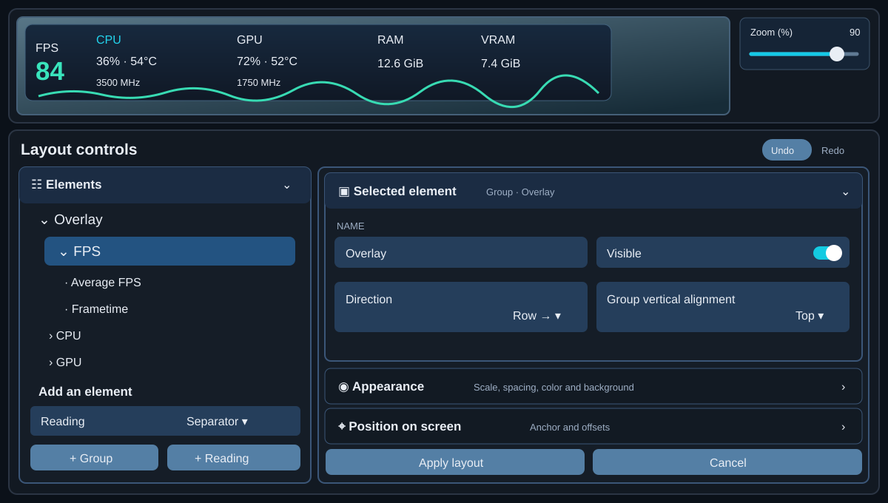
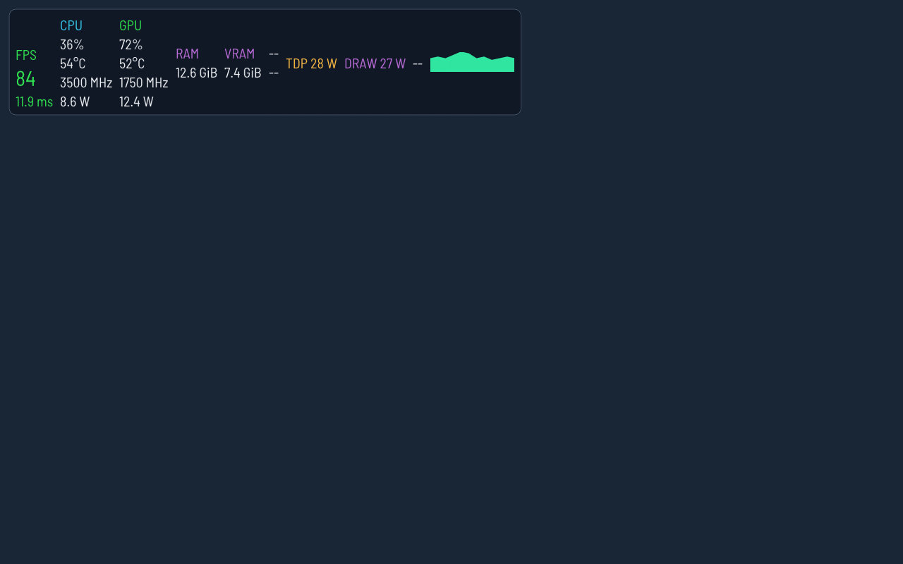
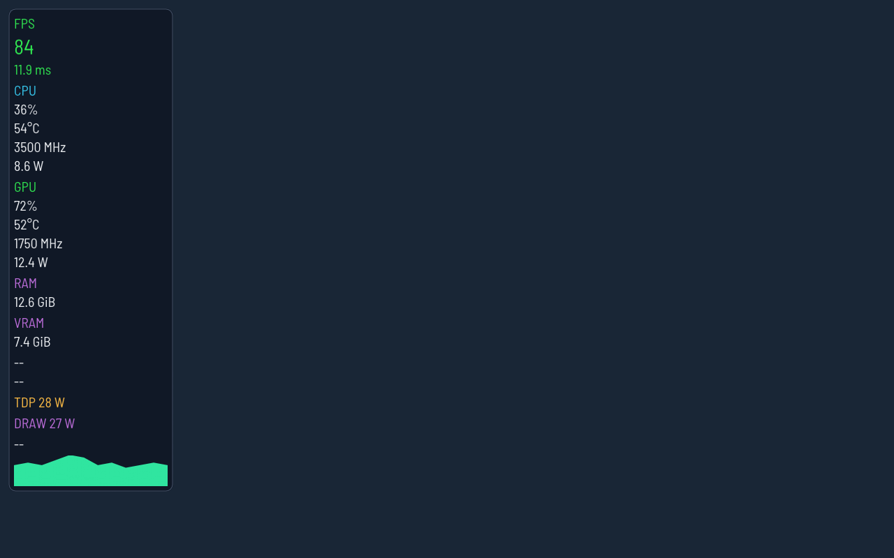
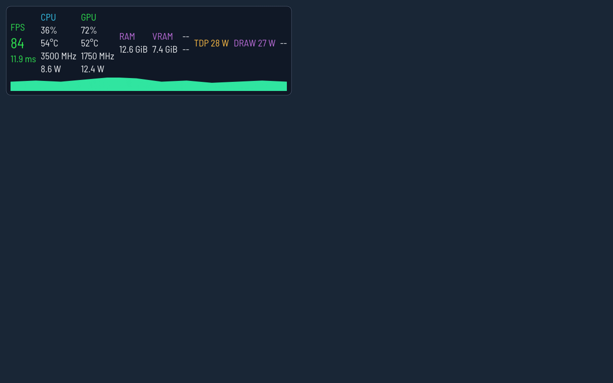

# Claw Metrics

**A customizable performance overlay for handheld PC games, controlled from Decky Loader's Quick Access Menu.** Choose the readings you need, build a compact horizontal HUD or a vertical stack, and tune its appearance without editing MangoHud configuration by hand.

[Download the latest test ZIP](https://github.com/Viber85/claw-metrics/releases/tag/v0.2.4-test.90) · [Current test source](https://github.com/Viber85/claw-metrics/tree/test/separator-controls) · [Report a problem](https://github.com/Viber85/claw-metrics/issues)

> **Experimental build.** The latest release's separator changes and editor exit behavior still need confirmation on a device running Bazzite 45.

## Preview



*Layout Builder illustration based on the current editor source. It shows the persistent preview and zoom control above the collapsible element tree and appearance controls. This is a schematic, not a device screenshot.*

The images below are **actual output of the bundled native ImGui renderer** from the `v0.2.4-test.90` render-fixture job, using sample sensor values on a 1280 × 800 canvas. They show the layout and font without a photographed game in the background.

| Horizontal overlay | Vertical overlay |
| --- | --- |
|  |  |



*Graph below the readings, rendered by the same native fixture. In the editor you can reorder readings, nest groups, place the graph, and save the result as a style in **Colors & Font**.*

## What you can customize

| Area | Options |
| --- | --- |
| Readings | FPS and frametime, CPU/GPU load and available sensors, RAM/VRAM, battery, time, TDP and battery draw. Sensor availability depends on the device. |
| Layout | Classic horizontal/vertical HUD or an editable layout with nested groups, element order, alignment, screen position and spacing. |
| Graphs and separators | Frametime graph styles and dimensions; separator elements in the builder. The classic horizontal HUD has separator color, height and thickness controls in test.90. |
| Appearance | Per-category colors and font weights, text/FPS size, solid or gradient background, opacity, rounded corners and optional outline. |
| Presets and diagnostics | Reusable saved styles, update checks, renderer status and local crash-session reports. Reports are not uploaded automatically. |

Claw Metrics bundles an isolated, modified MangoHud renderer for its advanced HUD features. It does not replace the system MangoHud installation or change hardware power limits. A classic renderer option remains available while testing editable layouts.

## Install and launch

1. Install [Decky Loader](https://decky.xyz/) on a compatible Linux handheld/Game Mode setup.
2. Download [ClawMetrics-v0.2.4-test.90.zip](https://github.com/Viber85/claw-metrics/releases/download/v0.2.4-test.90/ClawMetrics-v0.2.4-test.90.zip) and install that ZIP through Decky Loader. Existing plugin settings are migrated rather than intentionally reset.
3. In the plugin's **Activation** card, copy the launch command and paste it into the game's Steam **Launch Options**. The short command is:

   ```text
   ~/claw-metrics %command%
   ```

4. Fully restart the game so it loads the bundled renderer. Disable Steam's own performance overlay if you do not want two overlays at once.
5. Use **Metrics**, **Layout** and **Colors & Font** in the Quick Access Menu. **Advanced** can check whether a running game loaded the Claw renderer.

The launcher is created by the plugin on installation. If the short command is unavailable, use the command shown in **Activation** instead. Vulkan injection, sensor readings and controller behavior depend on the device, game and OS; the ZIP's automated checks are not a substitute for device testing.

## Status and source

The current test release is **v0.2.4-test.90**. Its source lives on [`test/separator-controls`](https://github.com/Viber85/claw-metrics/tree/test/separator-controls); the default `main` branch is a separate development line, so use that test branch when reviewing the code for this download. The release pipeline runs Python, TypeScript, ImGui and software Vulkan checks and verifies the installation ZIP. Bazzite 45 testing is ongoing; the new build still needs direct checks for separator appearance and QAM response after **Apply layout**.

Development details and the previous default-branch README are preserved in [the documentation archive](docs/README-v0.3.0-archive.md). Font licenses ship with the installation package.
